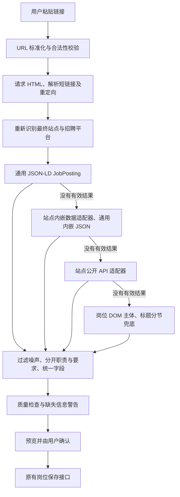

# 招聘岗位 URL 导入：架构与扩展指南

本轮在已有请求、结构化抽取和字段规范化模块上增补扩展入口，没有改写整个项目。没有新增依赖，没有改数据库表，也没有修改手动新增、粘贴 JD、编辑、删除、筛选、状态或备份接口。

## 1. 修改前的数据链路

| 用户操作 / 步骤 | 文件、函数或接口 | 输入 → 输出 |
| --- | --- | --- |
| 粘贴链接 | `app/page.tsx` 的 `JobForm` | 链接写入 `JobDraft.sourceUrl` |
| 点击“读取网页” | `normalizeUrl`、`importFromUrl` | 去掉空白、必要时补 HTTPS → `POST /api/jobs/import-url`，JSON 为 `{url}` |
| 检查权限 | `app/api/jobs/import-url/route.ts` 的 `authorizedOwner`、`POST` | 验证当前用户是工作区所有者 |
| 读取网页 / 平台数据 | `lib/job-web-platforms.ts` 的 `readJobUrl`、原 `platformIdentity/readPlatform` | URL → HTML 或平台 JSON |
| 请求控制 | `lib/job-web-fetch.ts` 的 `validateJobUrl/fetchJobPage/fetchJobJson` | 公开地址校验、逐跳检查、限时、限响应体大小 |
| 选取岗位 | `lib/job-web-extract.ts` 的 `extractStructuredJob/extractJobRegion/selectJobRecord` | JSON-LD、内嵌 JSON 或 DOM → 一个岗位对象 |
| 整理字段 | `recordToJob` → `lib/job-parser.ts` 的 `parseJobText` → `lib/job-import.ts` 的 `normalizeImportedJob` | 岗位对象 → `ImportedJob`，包含 `rawText` 和 `webDetails` |
| 展示预览 | 前端 `normalizeImportedJob/recognizedImportKeys` | 展示字段与警告；此时尚未保存 |
| 点击“确认并应用” | 前端 `applyRecognized` | 更新同一个 `JobDraft`，保留清理后的岗位原文 |
| 点击“保存” | 前端 `saveJob`、`mergeParsedJob`、`createJob/updateJob` | 新增调用 `POST /api/jobs`；编辑调用 `PATCH /api/jobs/:id` |
| 写入与返回 | 两个保存 Route → `getDb()` → Drizzle → D1 的 `jobs` 表；`presentJob` 返回页面模型 | `JobDraft` → 持久化岗位及匹配分析/准备清单 |

这里用的是 API Route，没有另一条用于 URL 导入的 Server Action。手动新增、粘贴 JD、URL 导入最终汇合到同一个岗位草稿和保存接口。

编辑会按字段白名单更新；删除仍用 `DELETE /api/jobs/:id`；筛选是现有前端逻辑；JSON/CSV 导出与 JSON 合并恢复仍由 `/api/data-backup` 处理。备份包含 `rawText`，因此补充信息可以随备份保留。

## 2. 最大的结构性问题

上一轮已解决整页噪声和三个具体链接，但站点规则仍同时散落在两个地方：总流程中的平台 `if` 分支，以及通用抽取器里的百度专用分支。新增平台要改动通用流程，容易影响原有网站。

更早的字节/小米问题是动态外壳未调用真实详情接口，百度问题则是整页宣传与 hydration store 的其他职位混入；这与“必须使用浏览器”不同。本轮针对的是后续扩展时的耦合问题，不把已修复的问题当作仍然存在。

## 3. 当前分层流程



已知平台的 HTML 无法读取时，允许尝试该平台已经实现的公开 API。明确的下线、错误 ID、验证码或访问限制不能伪装成成功导入。

### URL 标准化

`normalizeJobUrl` 只删除 `utm_*`、`gclid/fbclid/msclkid/_ga/_gl` 等明确追踪参数；飞书招聘门户的 `spread` 也可移除。未知参数保留，`jobId/jobUnionId/postId/projectId/token/source` 不会被一刀切删除。

Moka 的 `#/job/...` 路由保留；路由内部 query 也只删除明确追踪项。每次 HTTP 或 meta 跳转重新进行规范化和校验。短链接通过真实跳转解析，不猜测任意 query 中的地址。域名使用 URL 解析结果，去除结尾的点后再检查；识别公司时使用精确招聘域名，`careers.tencent.com.evil.example` 不会被当成腾讯。

### 站点、平台与雇主

`identifyJobSite` 返回 `JobSite`：`id/name/platform/company?`。例如：

- 字节官网：站点公司是字节跳动，平台是飞书招聘。
- 小米已知专属 tenant：站点公司是小米，平台是飞书招聘。
- 普通 Moka / 北森 / 飞书 tenant：只知道平台，不据此断言雇主是 Moka、北森或字节。

雇主优先级为：明确公司的招聘站点身份 → 岗位 `hiringOrganization/companyName` 等结构化雇主 → 适配器确认的 tenant 提示 → 现有公司词典。DOM 中明确标注的公司会进入同样的结构化字段。官方站点与页面招聘主体冲突时会返回警告；第三方平台中明确的岗位雇主优先于 tenant 兜底。

API 额外返回 `importSource`，记录站点身份、平台和实际采用的适配器；实际雇主仍是 `parsed.company`。旧响应字段没有移除。

### 相关性、职责和要求

- 仅从选中的目标岗位对象或岗位区域读字段，不拼接整页 body、站点配置字符串或全局菜单。
- URL 中有岗位 ID 时核对详情对象；多个岗位无法区分时拒绝导入。
- DOM 先排除导航、页脚、侧栏、推荐岗位、弹窗、登录区、社交链接、客服及功能按钮，再比较岗位区域的完整度。
- 识别中文职责/要求标题及 `Responsibilities/Qualifications/Requirements`；标题和 DOM 分节优先，没有标题时再做文字规则兜底。不会为了 URL 功能修改粘贴 JD 解析器的规则。
- 公司/品牌/团队介绍与推荐列表会过滤；实习对象、实习时长、出勤及薪资等岗位相关信息保留。这里使用可解释的规则，不调用新的模型或浏览器服务。
- `rawText` 由最终的岗位字段重新生成。因此职责与要求被分开后，原始混杂 description 不会再追加回来。
- 薪资支持常见文本及 JobPosting `baseSalary` 的币种、上下限、周期；不自行换算币种、日薪或月薪。未提供的数据留空。

新增薪资、实习时长、每周出勤等 `webDetails` 标签由现有前端预览自动展示。现有模型没有独立列的补充字段保存在 `rawText` 中；不承诺可以直接按这些补充字段筛选。

## 4. 适配器约定及扩展

目录是 `lib/job-web-adapters/`。统一约定只有：

```ts
type JobWebAdapter = {
  id: string;
  canHandle: (url: URL) => boolean;
  parse: (context: JobAdapterContext) => Promise<ExtractedWebJob | null>;
};
```

`context` 提供最终 `url`、已有 `html`、共用 `fetcher` 和 `stage`：

- `embedded`：只读页面内嵌详情；百度在此阶段处理 `detailData.postInfo`。
- `api`：调用已经验证过的公开详情接口；飞书、美团、Moka 在此阶段处理。

不属于自己的阶段或没有数据时返回 `null`；明确失效、受限或错岗位时抛出说明清楚的错误。所有适配器使用现有有界传输，映射为 `recordToJob` 接受的字段，并由同一质量检查返回结果。

增加腾讯深度适配的步骤：

1. 用一个真实岗位链接确认页面和公开详情数据源，保留岗位 ID 与必要参数；通用 JSON-LD 已可用就无需新适配器。
2. 新增 `lib/job-web-adapters/tencent.ts`，实现 `canHandle/parse`。只匹配腾讯招聘域名与实际路由，复用 `fetchJobJson`、`recordToJob`，不直接写数据库。
3. 在 `lib/job-web-adapters/index.ts` 导入并登记一行。总流程、前端及保存接口不需要改动。
4. 若是全新的雇主域名，可在 `job-web-sites.ts` 添加身份配置。腾讯站点身份已预留，但本轮没有未经验证地猜测腾讯 API。
5. 增加固定样例及错误 ID、下线/受限、噪声和保存兼容测试，再用真实链接验证。

当前有字节/小米共用的飞书适配器、百度适配器、美团适配器、Moka 适配器、小红书适配器，以及阿里适配器。腾讯、京东、滴滴、华为有明确招聘域名身份配置，并可进入通用解析链路；这不等于它们所有动态/私有页面已经适配。北森目前只识别为第三方平台，没有冒充已实现其专用接口。

### 阿里招聘（2026-10-17 新增）

`lib/job-web-adapters/alibaba.ts` 支持已核对的阿里招聘协议：`campus-talent.alibaba.com`、`talent.alibaba.com`、`talent-holding.alibaba.com`、`talent.taotian.com` 上的 `/campus/position/{id}` 和 `/campus|off-campus/position-detail?positionId=...` 等具体岗位路由。只匹配明确域名与数字 ID；不将招聘首页或职位列表当作岗位。

官网先返回前端页面框架，在 `window.__sysconfig` 中提供本次匿名会话的 CSRF 令牌和招聘频道；前端再调用同源 `POST /position/detail?_csrf=...`。适配器只读取脚本里的两个字面字符串，不运行远程 JavaScript，接口地址固定为当前官网同源地址。沿用已有有界请求，不新增依赖、浏览器或登录流程。

`fetchJobPage` 新增返回最终域名的临时 `sessionCookie`，经 `JobAdapterContext` 传给适配器，匹配页面 CSRF 会话。不同跳转域名的 Cookie 互相隔离，仅在当前导入期间存在，不写数据库、原文或 API 响应，也不读取用户浏览器登录 Cookie。

接口响应必须成功，岗位 ID 必须完全对应；明确停止招聘、要求登录、缺少正文等情况停止导入。职责、要求、地点、学历、批次、所属业务、实际发布时间、毕业时间范围按白名单提取。优先使用 `batchName` 判断日常实习或校招；社招入口作为缺失批次时的类型依据。保留已有公司词典规范名“阿里巴巴”，业务名称如“高德地图”存入所属部门。未证实含义的数值经验枚举不直接当作工作年限；修改时间不冒充发布时间，毕业时间不冒充投递截止时间。

真实链接验证：

| 链接 | 识别结果 |
| --- | --- |
| `https://campus-talent.alibaba.com/campus/position/199904160010?deptCodes=`（用户提供） | 平台产品经理（AI应用）；阿里巴巴；北京；日常实习；所属业务高德地图；职责与要求分开；保留专业及毕业时间范围 |
| `https://talent-holding.alibaba.com/off-campus/position-detail?positionId=100031360010` | 数据技术及产品部-平台运营与解决方案-MaaS产品；阿里巴巴；北京、杭州；社招；本科；实际发布时间及任职要求 |

未混入导航、推荐职位、宣传文案、HR 联系方式和投递按钮。用户提供岗位没有明确发布时间、投递截止日期、薪资和学历，保持缺失状态。两个链接已通过真实网络的完整 `readJobUrl` 流程；其他登记路由经过适配器契约测试，不代表逐一验证了所有阿里业务站点。遇到登录、人机验证或官网协议变化，仍会明确失败，可改用粘贴 JD。

构建后使用本地模拟登录身份调用 `/api/jobs/import-url`：上述阿里校招和社招链接，以及原有百度、小米、字节、小红书链接，六项均返回 200，岗位名称、职责和要求完整。64 项自动测试、TypeScript 检查、新增及修改后端模块的 ESLint 和生产构建通过。检查仅生成导入预览，未保存测试岗位或改动已有数据。已用 `npm.cmd run local:preview` 启动新构建。

本次文件职责：`alibaba.ts` 实现阿里路由、页面令牌、频道和详情字段映射；`index.ts` 注册适配器；`types.ts`、`job-web-fetch.ts`、`job-web-platforms.ts` 仅补充传递当前域名的匿名会话；`job-web-sites.ts` 补齐校招和控股集团域名身份；`app/page.tsx` 只更新入口支持说明；`tests/alibaba-import.test.mjs` 验证新协议及会话隔离。不改 JD 文本解析器、数据库结构和原岗位保存接口。

### 小红书（2026-10-16 新增）

`lib/job-web-adapters/xiaohongshu.ts` 识别官网的社招、校招、实习、分享和主题岗位详情路由。官网 HTML 目前是空的 Vue 页面框架，适配器调用官网前端使用的公开 `GET /websiterecruit/position/queryPositionDetail?positionId=...`，无需登录 Cookie、浏览器自动化或新增依赖。

仅接受成功响应、与链接完全一致的 `positionId`、`in_recruitment` 招聘状态以及有效的岗位名称和正文。按白名单取 `positionName/duty/qualification/workplace/recruitType/education` 等字段；HR 联系方式、投递操作、推荐职位不进入岗位原文。再复用 `recordToJob` 分离职责与要求，提取专业、实习时长、出勤要求。缺失日期或薪资不编造。

真实链接 `https://job.xiaohongshu.com/campus/intern/position/21729` 已验证：AI策略产品经理（大模型/Agent方向）实习、小红书、北京市、日常实习；职责与要求分开，保留每周 5 天、连续实习 6 个月及以上和相关专业要求。接口没有提供发布时间、截止日期、薪资或明确学历，保留缺失状态。其他路由通过适配器契约测试，未逐一验证所有官网真实岗位。小红书笔记、招聘搜索列表和旧版手机路由不作为已适配的具体岗位。

本次构建后通过带本地登录身份的 `POST /api/jobs/import-url` 实测：上述小红书岗位及此前用户提供的字节、百度、小米三个链接全部返回 200，均获得公司、岗位、职责和要求。检查仅生成导入预览，未新增或改动已保存岗位。

## 5. 本轮文件变更及原因

| 文件 | 原本作用 | 本轮修改 / 新增内容 | 原因 |
| --- | --- | --- | --- |
| `lib/job-web-platforms.ts` | 读取总流程与平台 if 分支混合 | 只保留分层调度、适配器调用、质量检查及来源信息 | 新网站无需修改主流程 |
| `lib/job-web-fetch.ts` | URL 校验与有界 HTTP | 增加保守 URL 标准化，并用于每次跳转；保留 hash 路由 | 清理追踪，不丢岗位参数 |
| `lib/job-web-extract.ts` | 通用结构化/DOM 抽取，混有百度分支 | 导出通用内嵌 JSON 读取、移走百度专属规则；补齐分节、薪资、雇主优先级、岗位区域完整度 | 通用能力与网站协议分离；减少误分类与漏字段 |
| `lib/job-web-sites.ts` | 无 | 站点/平台/公司身份表 | 平台不是雇主；域名识别可独立维护 |
| `lib/job-web-adapters/types.ts` | 无 | 小型 `canHandle/parse` 契约 | 所有网站以相同方式接入 |
| `lib/job-web-adapters/index.ts` | 无 | 唯一适配器注册表 | 新平台只登记一行 |
| `lib/job-web-adapters/feishu.ts` | 逻辑在平台分支中 | 移入共享飞书详情接口适配 | 字节、小米及同协议 tenant 复用 |
| `lib/job-web-adapters/baidu.ts` | 逻辑在通用抽取器中 | 移入百度详情 store 读取 | 不污染通用 JSON 解析器 |
| `lib/job-web-adapters/meituan.ts` | 逻辑在平台分支中 | 移入美团公开接口和类型映射 | 保留原功能、隔离协议差异 |
| `lib/job-web-adapters/moka.ts` | 逻辑在平台分支中 | 移入 Moka hash/tenant/API 逻辑 | 第三方 tenant 与岗位雇主分开 |
| `lib/job-import.ts` | 统一字段清理及补充预览标签 | 补充薪资、实习时长、出勤白名单标签 | 复用既有预览和统一岗位模型 |
| `app/api/jobs/import-url/route.ts` | 权限与导入响应 | 附加 `importSource` | 让实际使用的站点/适配器可追溯 |
| `tests/job-web-architecture.test.mjs` | 无 | 扩展契约、URL 保留、跳转、公司来源、分节与薪资测试 | 验证架构能力而非只测三个成功样例 |
| `tests/job-web-import.test.mjs` | 原导入回归测试 | 旧美团/Moka 样例明确区分 HTML 和 API 阶段 | 验证结构化优先仍保持平台兼容 |
| 本文与上一轮验证文档入口 | 上一轮实现记录 | 新增本轮架构、文件表、扩展步骤 | 区分历史修复与当前扩展设计 |

`app/page.tsx`、`lib/job-parser.ts`、`lib/company-knowledge.mjs`、`db/*`、新增/编辑/删除/备份 Route 本轮均未修改。没有新增依赖，也没有修改锁文件。

## 6. 验证范围

- 64 项自动测试通过：包含原有文本导入、排序、公司识别、可选浏览器集成，以及 URL 去噪、平台适配和架构扩展测试；小红书 ID、下线岗位、正文过滤、招聘类型，以及阿里匿名会话、跨域 Cookie 隔离、ID 校验、失效/登录响应、毕业时间和发布时间测试。
- TypeScript 检查和受改服务端模块 ESLint 检查通过；生产构建通过。
- 使用之前提供的字节、百度、小米原链接重新请求，正确取得原岗位和字段；小米的 `spread` 被去掉，岗位 ID 保留。三个网站未提供的字段仍留空。
- 本地真实 HTTP 导入、保存/读取/删除，以及手动新增、编辑、状态修改、JSON 导出和合并恢复通过回归验证。临时岗位已删除，测试前后已有岗位内容校验值一致。没有对全部十家公司的动态岗位宣称真实验证。

常用验证命令：

```powershell
node --test --test-isolation=none tests/alibaba-import.test.mjs tests/xiaohongshu-import.test.mjs tests/job-web-architecture.test.mjs tests/job-web-import.test.mjs tests/company-knowledge.test.mjs tests/job-parser.test.mjs tests/job-order.test.mjs tests/optional-browser-tools.test.mjs
node node_modules/typescript/bin/tsc --noEmit --incremental false
npm.cmd run build
```

`--test-isolation=none` 用于本机 Node 24 单进程测试，避免测试子进程限制；其他兼容环境可使用默认隔离运行。运行项目仍用 `npm.cmd run local:preview`。登录、验证码、频控、短链依赖 JavaScript 或未适配私有接口等情况会明确失败，允许改用文本粘贴，不引入重型浏览器兜底。
